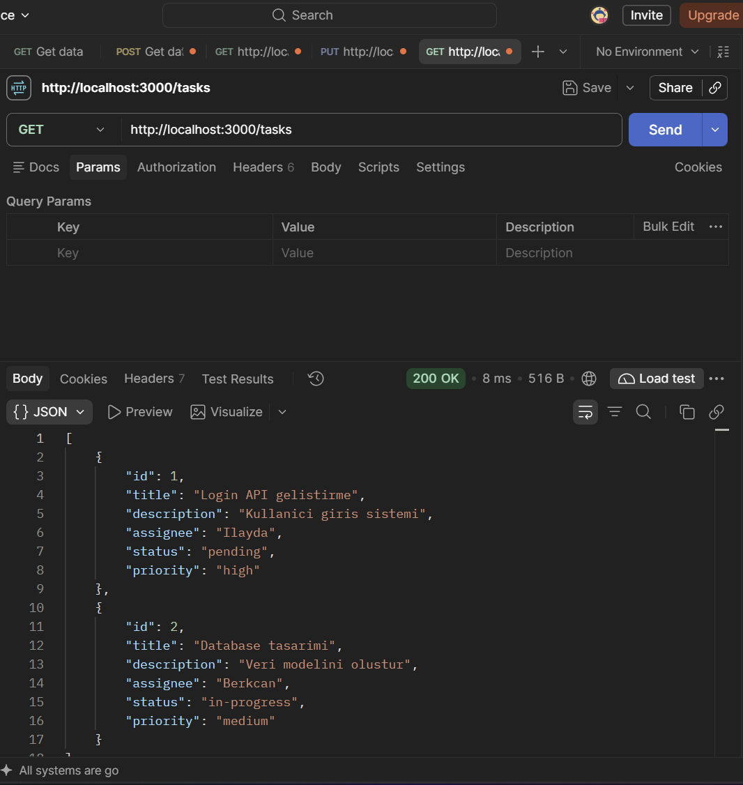
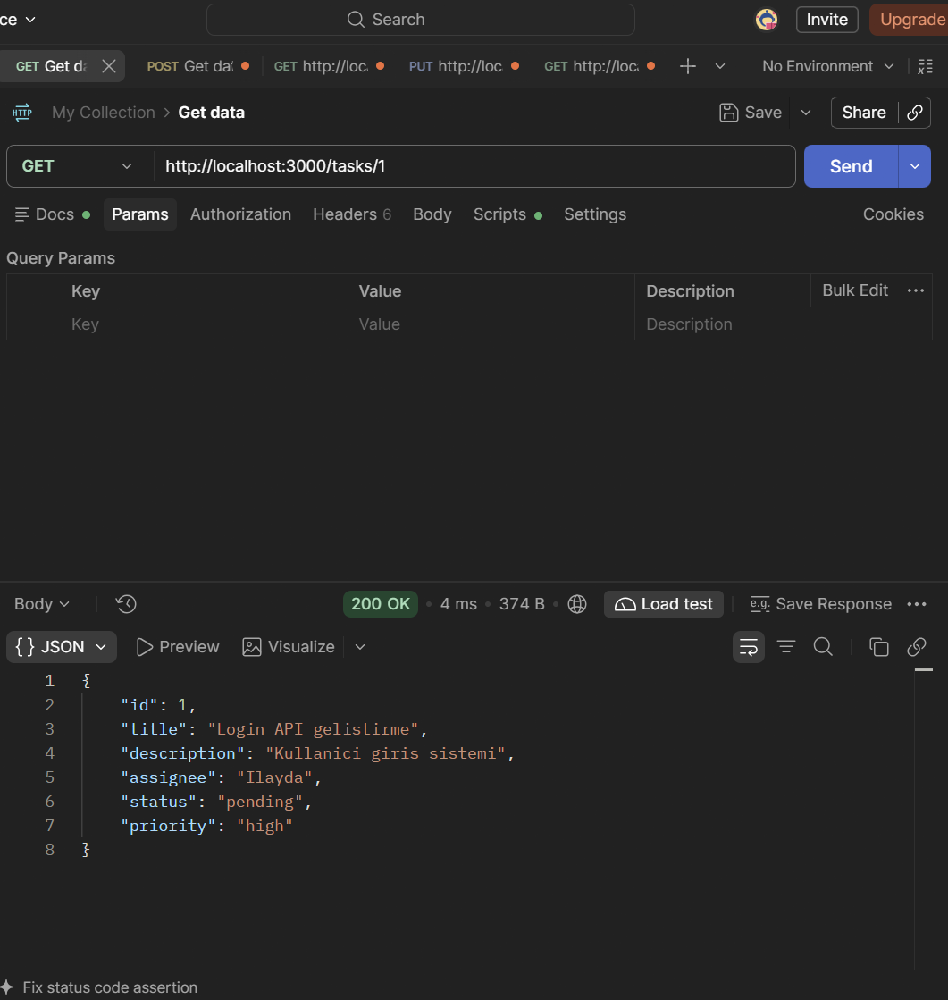
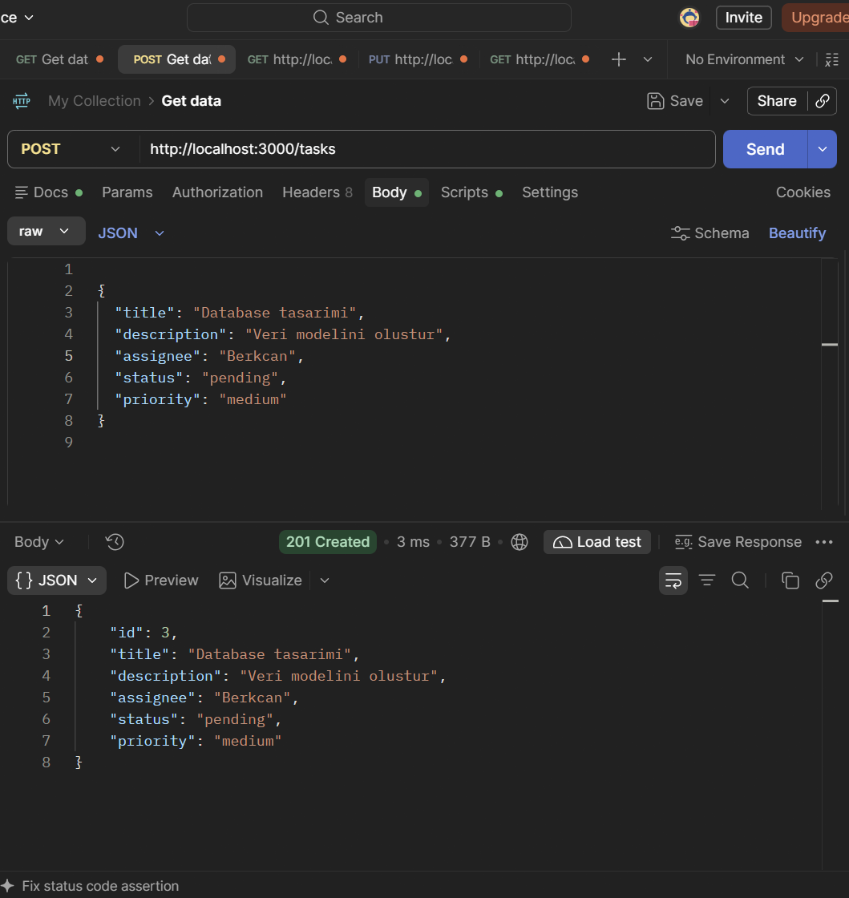
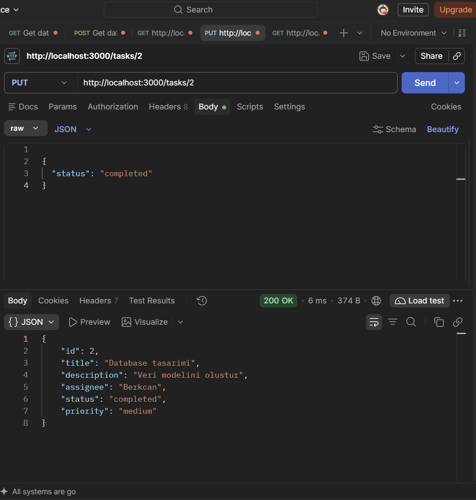
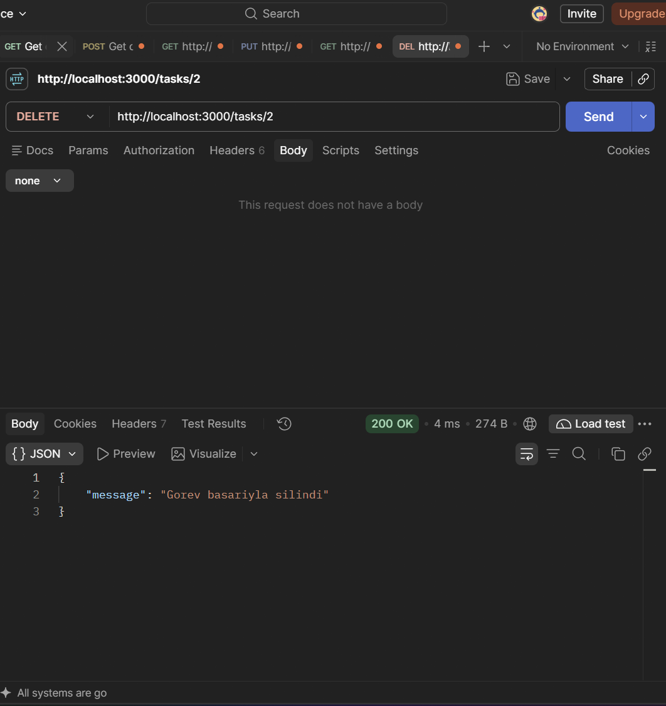
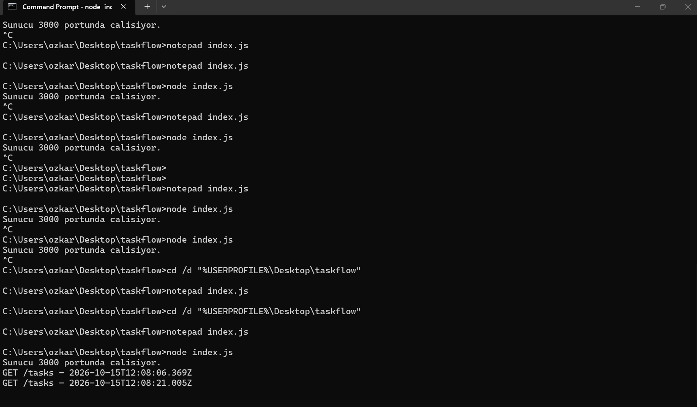

\# TASKFLOW - Görev Yönetim API Projesi


\## Proje Hakkında


Bu projede Node.js ve Express.js kullanarak basit bir görev yönetim API'si geliştirdim. Amaç, bir ekipteki görevlerin oluşturulmasını, görüntülenmesini, güncellenmesini ve silinmesini sağlamak.


Her görev için başlık, açıklama, sorumlu kişi, öncelik ve durum bilgileri tutuluyor.


\## Kullanılan Teknolojiler


\- Node.js

\- Express.js

\- JavaScript

\- Postman


\## Projenin Çalıştırılması


Projeyi çalıştırmak için bilgisayarda Node.js kurulu olması gerekiyor.


Öncelikle terminal üzerinden proje klasörüne girilir ve gerekli paketler yüklenir:


`npm install`


Ardından sunucu başlatılır:


`node index.js`


Sunucu 3000 portunda çalışır.


API adresi: `http://localhost:3000`


\## API İşlemleri


| Metot | Adres | Açıklama |

|---|---|---|

| GET | /tasks | Bütün görevleri listeler |

| GET | /tasks/:id | ID'ye göre bir görevi getirir |

| POST | /tasks | Yeni görev ekler |

| PUT | /tasks/:id | Var olan görevi günceller |

| DELETE | /tasks/:id | Görevi siler |


\## Örnek Görev


```json

{

&#x20; "title": "Database tasarimi",

&#x20; "description": "Veri modelini olustur",

&#x20; "assignedTo": "Berkcan",

&#x20; "priority": "medium",

&#x20; "status": "pending"

}

```


\## Logger Middleware


Projeye gelen HTTP isteklerini takip etmek için bir logger middleware ekledim.


Bu yapı, gelen isteğin metodunu, adresini ve zaman bilgisini CMD ekranına yazdırıyor.


Örneğin:


`GET /tasks - 2026-10-15T12:08:06.369Z`


\## Testler


API işlemlerini Postman üzerinden test ettim. Görev ekleme, listeleme, güncelleme ve silme işlemlerinin çalıştığını kontrol ettim.


Test sırasında aldığım ekran görüntülerini `Screenshots` klasörüne kaydettim.


\## Not


Bu projede veriler JavaScript dizisinde tutuluyor. Henüz bir veritabanı kullanılmadığı için sunucu kapatılıp tekrar açıldığında sonradan eklenen görevler kayboluyor.

## Postman Test Ekran Görüntüleri

### 1. GET - Görevleri Listeleme


### 2. GET - ID ile Görev Getirme


### 3. POST - Yeni Görev Oluşturma


### 4. PUT - Görev Güncelleme


### 5. DELETE - Görev Silme


### 6. Logger Middleware


